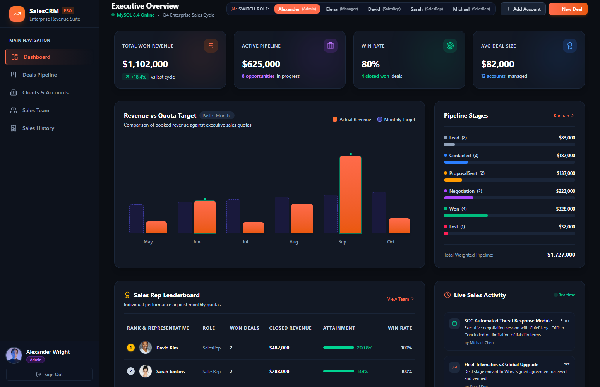
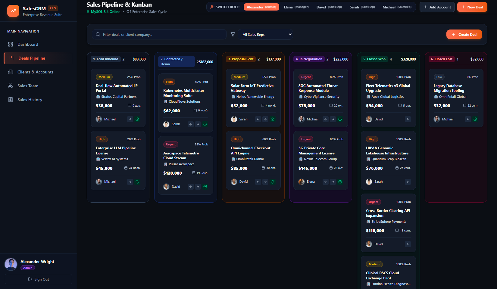
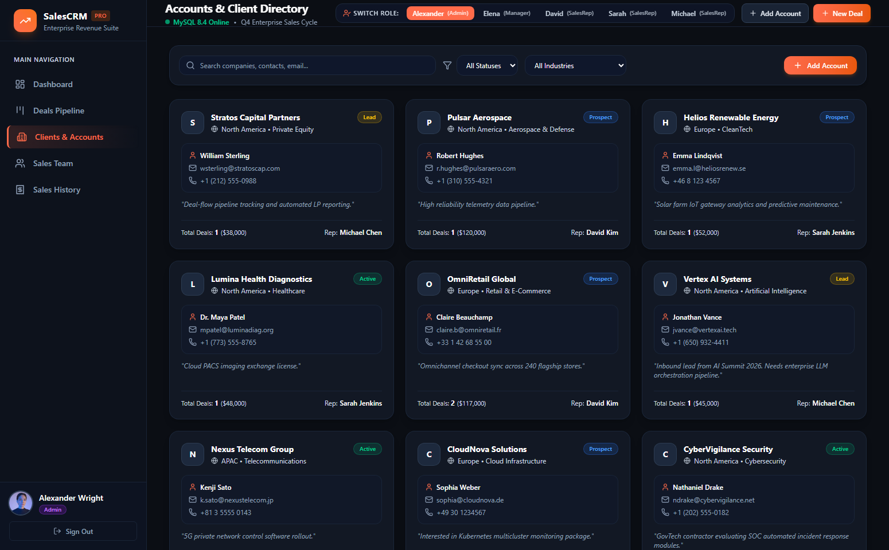
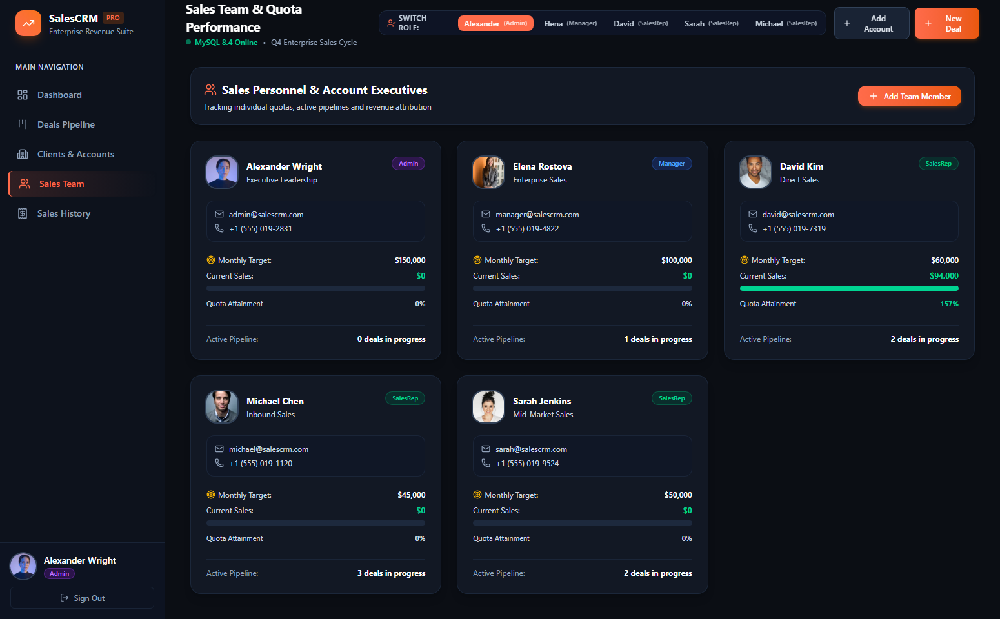
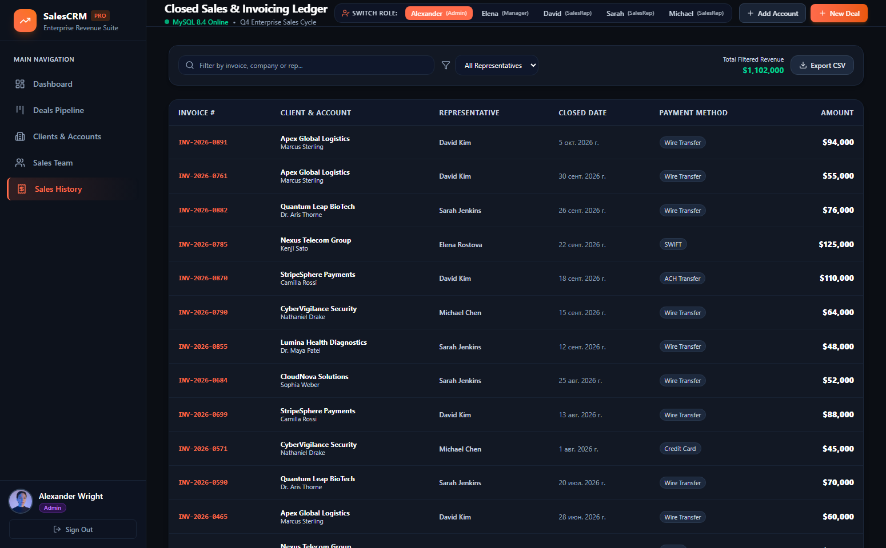
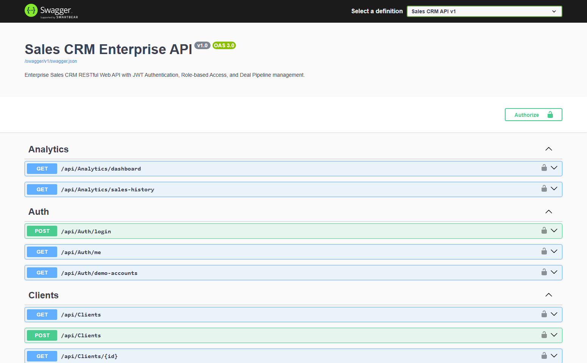

# 💼 SalesCRM Enterprise — Sales Intelligence & Pipeline Management Suite

<p align="center">
  
  
  
  
  
  
</p>

---

## 📌 Обзор проекта

**SalesCRM Enterprise** — это корпоративная CRM-система для отделов B2B-продаж, созданная на современном стеке **ASP.NET Core Web API + React 19 + TypeScript + MySQL**. Проект спроектирован с упором на аналитику выручки, сквозное управление воронкой сделок (Kanban Pipeline), контроль выполнения индивидуальных и командных планов продаж (Quotas & Attainment), а также строгую ролевую модель доступа (RBAC).

Система объединена в единый самодостаточный запуск: **ASP.NET Core Web API** обслуживает как RESTful API и Swagger-документацию, так и скомпилированное React SPA клиентское приложение на едином порту (`http://localhost:5200`).

---

## 📸 Скриншоты интерфейса

### 1. Executive Dashboard (Главный аналитический дашборд)
> Полноэкранный мониторинг ключевых показателей продаж (KPIs), интерактивный график выручки к целевым квотам (Revenue vs Target), распределение сделок по стадиям воронки, рейтинг менеджеров и лента активности в реальном времени.



---

### 2. Deals Pipeline & Kanban Board (Интерактивная воронка сделок)
> 6-колоночный Kanban-пайплайн (`Lead` ➔ `Contacted` ➔ `Proposal Sent` ➔ `Negotiation` ➔ `Closed Won` ➔ `Closed Lost`) с индикацией вероятности успеха, приоритетов, сумм по каждой стадии, мгновенным переводом между этапами и журналом активности по каждой сделке.



---

### 3. Accounts & Client Directory (База корпоративных клиентов)
> Карточки и каталог контрагентов с фильтрацией по отраслям (FinTech, BioTech, AI, Logistics, CleanTech), регионам (North America, Europe, APAC) и статусам жизненного цикла с привязкой персональных менеджеров.



---

### 4. Sales Team & Quota Performance (Отдел продаж и выполнение плана)
> Мониторинг эффективности торговых представителей: месячный таргет, закрытая выручка, процент достижения квоты (Quota Attainment) с цветовыми индикаторами и распределением активных сделок.



---

### 5. Closed Sales & Invoicing Ledger (История продаж и реестр счетов)
> Финансовый журнал завершённых транзакций с номерами инвойсов, способами взаиморасчётов (Wire Transfer, SWIFT, ACH), датами закрытия и возможностью экспорта в CSV.



---

### 6. Swagger API Documentation (Интерактивная спецификация REST API)
> Документированные эндпоинты с поддержкой авторизации через заголовок `Bearer {token}`.



---

## 🚀 Ключевые возможности и архитектурные решения

- 🔐 **Аутентификация и безопасность:**
  - JWT Bearer токены с проверкой срока жизни и цифровой подписью HMAC-SHA256.
  - Хеширование паролей алгоритмом **BCrypt**.
  - Ролевая модель доступа (RBAC): `Admin` (полный доступ), `Manager` (управление отделом), `SalesRep` (работа с закреплёнными сделками).
  - Удобный **1-Click Demo Switcher** в шапке приложения для моментального тестирования прав разных ролей.

- 📊 **Финансовая и коммерческая аналитика:**
  - KPI-метрики: Total Won Revenue, Active Pipeline Value, Win Rate %, Average Deal Size.
  - Динамический график сравнения фактической выручки с таргетами за последние 6 месяцев.
  - Рейтинг менеджеров (Leaderboard) с расчётом конверсии и перевыполнения квот.

- 📋 **Интерактивный Kanban воронки сделок:**
  - Мгновенное продвижение этапов сделки.
  - Автоматическая генерация финансовой записи (`SaleRecord`) с уникальным номером инвойса при переводе сделки в статус `Closed Won`.
  - Встроенный таймлайн коммуникаций (звонки, встречи, письма, заметки).

- 🗄️ **Надёжная база данных MySQL 8.4:**
  - Использование **Entity Framework Core (Pomelo)** с автоматическим накатыванием схемы (`EnsureCreated`).
  - Предзаполненный реалистичный датасет (5 сотрудников, 12 корпоративных аккаунтов, 13 сделок, история за 6 месяцев на $1,100,000+).

---

## 🏗️ Структура проекта

```
SalesCRM/
├── backend/
│   └── SalesCRM.Api/
│       ├── Controllers/            # API Контроллеры (Auth, Deals, Clients, Users, Analytics)
│       ├── Data/                   # CrmDbContext и DbInitializer (демо-данные)
│       ├── DTOs/                   # Запросы и ответы API
│       ├── Models/                 # Доменные сущности (User, Client, Deal, DealActivity, SaleRecord)
│       ├── Services/               # JWT Service генерации и валидации токенов
│       ├── wwwroot/                # Скомпилированный React SPA бандл
│       ├── appsettings.json        # Конфигурация MySQL и JWT
│       └── Program.cs              # Конфигурация DI, CORS, JWT, Swagger, SPA Routing
├── frontend/
│   ├── src/
│   │   ├── api/                    # Клиент API с перехватом токенов
│   │   ├── components/             # React компоненты (Dashboard, Kanban, Clients, Team, History)
│   │   ├── types/                  # TypeScript интерфейсы
│   │   ├── App.tsx                 # Корневой компонент с управлением сессией
│   │   └── index.css               # Стили Tailwind CSS v4 и палитра Executive Dark
│   ├── package.json
│   └── vite.config.ts              # Конфигурация сборки и сборка в wwwroot
├── database/
│   └── schema.sql                  # Чистый SQL-скрипт создания базы и таблиц
├── screenshots/                    # Скриншоты высокого разрешения для документации
├── SalesCRM.slnx                   # Solution файл .NET
└── README.md                       # Техническая документация
```

---

## 🔑 Тестовые учётные записи для проверки

При первом открытии система автоматически авторизует вас под администратором, либо вы можете переключаться в один клик через панель в шапке:

| Роль | Сотрудник | Email | Пароль | Описание прав |
|---|---|---|---|---|
| **Admin** | Alexander Wright | `admin@salescrm.com` | `Admin123!` | Полный доступ ко всем модулям, редактирование квот и сотрудников |
| **Manager** | Elena Rostova | `manager@salescrm.com` | `Manager123!` | Управление отделом продаж, просмотр сделок и аналитики |
| **SalesRep** | David Kim | `david@salescrm.com` | `Rep123!` | Старший менеджер по корпоративным клиентам ($482k закрыто) |
| **SalesRep** | Sarah Jenkins | `sarah@salescrm.com` | `Rep123!` | Менеджер по работе со средним бизнесом |
| **SalesRep** | Michael Chen | `michael@salescrm.com` | `Rep123!` | Менеджер входящих лидов |

---

## 🛠️ Инструкция по запуску

### Предварительные требования
1. **.NET 8 SDK** или **.NET 10 SDK**
2. **Node.js** (v18+) и **npm**
3. **MySQL Server** 8.0 / 8.4 (по умолчанию: `localhost:3306`, логин `root`, пароль `NewPassword123!`)

### Шаг 1. Клонирование репозитория
```bash
git clone https://github.com/TikTak-creator/SalesCRM.git
cd SalesCRM
```

### Шаг 2. Настройка подключения к MySQL
Проверьте строку подключения в файле `backend/SalesCRM.Api/appsettings.json`:
```json
"ConnectionStrings": {
  "DefaultConnection": "Server=localhost;Port=3306;Database=sales_crm_db;User=root;Password=NewPassword123!;TreatTinyAsBoolean=true;CharSet=utf8mb4;"
}
```

### Шаг 3. Запуск приложения (Single Command)
При запуске бэкенда база данных создастся и наполнится автоматически:
```bash
cd backend/SalesCRM.Api
dotnet run --launch-profile http
```

Приложение доступно:
- **Web CRM UI:** [http://localhost:5200](http://localhost:5200)
- **Swagger API Docs:** [http://localhost:5200/swagger](http://localhost:5200/swagger)

*(Опционально) Если вы хотите модифицировать фронтенд:*
```bash
cd frontend
npm install
npm run dev      # Запуск Vite сервера разработчика на http://localhost:3000
npm run build    # Компиляция изменений прямо в wwwroot бэкенда
```

---

## 🔌 Спецификация REST API

| Метод | Эндпоинт | Доступ | Назначение |
|---|---|---|---|
| `POST` | `/api/auth/login` | Public | Вход в систему, получение JWT токена |
| `GET` | `/api/auth/me` | Authenticated | Профиль текущего авторизованного пользователя |
| `GET` | `/api/auth/demo-accounts` | Public | Список аккаунтов для быстрого переключения |
| `GET` | `/api/analytics/dashboard` | Authenticated | Полная сводка KPIs, графики и рейтинг |
| `GET` | `/api/analytics/sales-history`| Authenticated | Финансовый реестр закрытых продаж |
| `GET` | `/api/deals` | Authenticated | Список сделок с фильтрацией по статусу и менеджеру |
| `GET` | `/api/deals/kanban` | Authenticated | Группировка сделок по 6 стадиям воронки |
| `POST` | `/api/deals` | Authenticated | Создание новой коммерческой возможности |
| `PUT` | `/api/deals/{id}/stage` | Authenticated | Смена стадии сделки и создание инвойса при Won |
| `POST` | `/api/deals/{id}/activities` | Authenticated | Добавление взаимодействия (звонок/встреча) |
| `GET` | `/api/clients` | Authenticated | Реестр корпоративных контрагентов |
| `POST` | `/api/clients` | Authenticated | Добавление новой компании в CRM |
| `GET` | `/api/users` | Authenticated | Команда продаж, таргеты и выполнение плана |
| `POST` | `/api/users` | Admin, Manager | Регистрация нового торгового представителя |

---

## 📄 Лицензия
MIT License. Разработано для портфолио full-stack разработки на платформе .NET и React.
